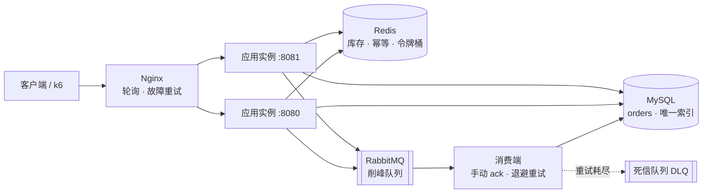
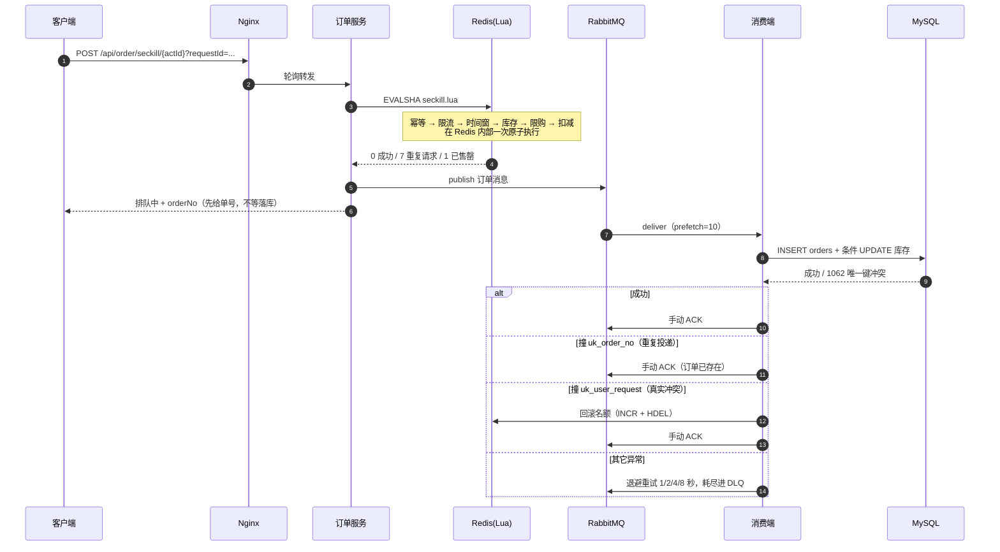

# 音响商城后端（audio-mall）

一个按 **「先让它坏，再修好」** 原则写的秒杀商城后端：每个技术决定都对应一次"不做会坏"的实验，
结论和推翻过程都留在 `docs/` 里。

核心不是"把功能做完"，而是能回答三个问题：**为什么会超卖 / 为什么会重复下单 / 瓶颈到底在哪一层。**

---

## 技术栈

| 层 | 选型 |
|---|---|
| 语言 / 框架 | Java 21、Spring Boot 3.5.16 |
| 持久层 | MyBatis 3.x（XML 映射）、MySQL 8.0 |
| 缓存 / 原子操作 | Redis 7.4（Lettuce 连接池、Lua 脚本） |
| 消息 | RabbitMQ 3.13（手动 ack、DLX 死信） |
| 认证 | JWT（jjwt 0.11.5）+ Redis 单端登录 |
| 接口文档 | SpringDoc（生产环境关闭） |
| 压测 | k6、wrk、redis-benchmark |
| 部署 | Docker Compose（中间件）+ 云服务器 |

---

## 整体架构



应用是**无状态**的：库存、幂等键、登录态全在 Redis/MySQL/MQ，所以 Nginx 用默认轮询即可，
不需要粘性会话；杀掉一个实例，另一个照常服务。

---

## 核心链路：一次秒杀



> 可交互版本（带代码位置溯源）：[`docs/diagrams/seckill-sequence.html`](docs/diagrams/seckill-sequence.html)
> 源文件：[`docs/diagrams/seckill-sequence.json`](docs/diagrams/seckill-sequence.json)

---

## 四个关键设计

### 1. 库存一致性：Redis 扣"名额"，MySQL 记"账本"

- 库存的**唯一权威**在 Redis（`audio:seckill:stock:{actId}`），扣减在 Lua 里完成，
  检查和扣减之间没有窗口，因此不会超卖。
- MySQL 里的 `stock` 是**账本**，由消费端在事务里做条件 UPDATE（`WHERE stock >= n`）。
- 一旦 DB 侧判定为「真实冲突」，必须把 Redis 名额加回去 —— 否则名额凭空消失，
  表现为"明明没卖完却抢不到"。

### 2. 幂等的三道闸

| 闸 | 位置 | 作用 |
|---|---|---|
| ① 只读快路径 | Lua 开头 `GET` 幂等键 | 重复请求立刻返回上次的 orderNo，不消耗令牌、不碰库存 |
| ② 幂等键写入 | Lua 尾部 `SET NX` | 写成功才算"第一次"，写失败说明并发重复 |
| ③ 数据库唯一索引 | `uk_user_request` / `uk_order_no` | 兜住绕过 Redis 的重复（消息重投、重试） |

### 3. 削峰与兜底：MQ + 手动 ack + 重试 + 死信

- 请求线程只做 Redis 那一下，落库交给消费端 —— **响应时间不再被数据库决定**。
- **手动 ack**：处理成功才确认；进程崩了消息会回队列重投（不丢），代价是可能重复消费，
  由第 2 点的第三道闸兜住。这两件事是配套的。
- 失败退避 1/2/4/8 秒，重试耗尽进死信队列，不阻塞后面的消息。

### 4. 无状态多实例

- 所有状态外置，两个 JVM 共享 Redis/MySQL/MQ。
- Nginx 轮询 + `max_fails=3 fail_timeout=5s`：杀掉一个实例，**30 次请求全部成功**，
  切换代价约 2 ms，实例恢复后自动回到轮询。
- 双实例是为了**可用性**，不是为了吞吐 —— 实测 200 并发下，单实例和双实例都是约 1 万 QPS，
  瓶颈在共享的 Redis/连接上。

---

## 实测数据

| 场景 | 吞吐 | 平均延迟 | 瓶颈 |
|---|---|---|---|
| 本机 8C16T，200 并发，纯读 | **10,900 QPS** | 18.6 ms | Redis 往返 / 连接 |
| 本机同一接口，日志级别 DEBUG | 3,883 QPS | — | **日志同步写盘**（压在请求线程上） |
| 4 核云服务器，回环直连应用 | **7,214 QPS** | 14.2 ms | 4 核 CPU 打满 |
| 4 核云服务器，回环经 Nginx | 5,159 QPS | 19.8 ms | 同上 + Nginx 开销（约 28%） |
| 4 核云服务器，公网 3 Mbps | 419 QPS | 510 ms | **公网带宽** |

> 不同环境的数字**不能直接比较**：一个是 16 线程无争抢，一个是 4 核里近一半被压测工具占用，
> 还有一个卡在 3 Mbps 的带宽上。所以简历上不写绝对 QPS。
>
> 一条经验：`吞吐 = 并发 ÷ 延迟`（Little's law）只在没撞到带宽上限时成立。
> 先算"这条管道每秒能吐多少字节"，那个才是真天花板。

---

## 快速开始（本地）

### 1. 起中间件

```bash
# MySQL 用 3307，避免和本机已有的 3306 冲突
docker run -d --name audio-mall-mysql -p 3307:3306 \
  -e MYSQL_ROOT_PASSWORD=root123456 -e MYSQL_DATABASE=audio_mall \
  mysql:8.0

docker run -d --name audio-mall-redis -p 6379:6379 \
  redis:7.4-alpine redis-server --requirepass redis123456 --appendonly yes

docker run -d --name audio-mall-rabbitmq -p 5672:5672 -p 15672:15672 \
  -e RABBITMQ_DEFAULT_USER=admin -e RABBITMQ_DEFAULT_PASS=admin123456 \
  rabbitmq:management
```

### 2. 建表

```bash
docker exec -i audio-mall-mysql mysql -uroot -proot123456 --default-character-set=utf8mb4 audio_mall < sql/01-init.sql
docker exec -i audio-mall-mysql mysql -uroot -proot123456 --default-character-set=utf8mb4 audio_mall < sql/02-order.sql
# 可选：压测用商品数据
docker exec -i audio-mall-mysql mysql -uroot -proot123456 --default-character-set=utf8mb4 audio_mall < sql/03-loadtest-data.sql
```

### 3. 配置

```bash
# application.yml 含本地密码，不进版本库，从模板复制
cp src/main/resources/application.yml.example src/main/resources/application.yml
```

### 4. 启动

```bash
mvn spring-boot:run
# 或
mvn -q -DskipTests package
java -jar target/audiobackend-0.0.1-SNAPSHOT.jar
```

首次启动会自动创建管理员 `admin / admin123`（`DataInitializer`）。

### 5. 冒烟

```bash
curl 'http://localhost:8080/api/product/page?pageNum=1&pageSize=3'
curl 'http://localhost:8080/api/seckill/1'
```

### 6. 集成测试

```bash
mvn -q test -Dtest=SeckillIT   # 4 条：重复提交 / 50 线程并发重复 / 索引冲突回滚 / 100 库存 200 并发不超卖
```

---

## 目录结构

```
src/main/java/com/example/audiobackend/
├── controller/      接口层
├── service/impl/    业务实现（秒杀、订单、支付、商品、用户、上传）
├── listener/        MQ 消费者（手动 ack + 重试 + 死信）
├── mapper/          MyBatis 接口
├── interceptor/     JWT 拦截器
├── config/          配置（数据初始化、MQ 声明、上传映射）
├── task/            定时任务（订单超时关闭、活动结束）
└── common/          统一响应、异常处理

src/main/resources/
├── lua/seckill.lua      秒杀原子脚本（限流 / 时间窗 / 库存 / 限购 / 幂等）
├── mapper/*.xml         SQL 映射
├── application.yml      本地配置（不进版本库）
└── application-prod.yml 生产配置（占位符全部来自环境变量）

docs/        实验与部署记录
deploy/      生产部署编排（Compose / systemd / Nginx）
loadtest/    k6 压测脚本与数据重置脚本
sql/         建表与种子数据
frontend/    早期静态站点（本次后端重构未使用）
```

---

## 文档索引

| 文档 | 内容 |
|---|---|
| [docs/可靠性实验.md](docs/可靠性实验.md) | 关掉 Redis / MySQL 会怎样，以及改前改后的对比 |
| [docs/瓶颈定位实验.md](docs/瓶颈定位实验.md) | 那条被推翻的"瓶颈是 Redis"结论，和真正的元凶 |
| [docs/双实例实验.md](docs/双实例实验.md) | 双实例 + Nginx，含故障切换实测 |
| [docs/压测记录.md](docs/压测记录.md) | 从 3,883 到 10,900，以及真实服务器上的重测 |
| [docs/集成测试.md](docs/集成测试.md) | 4 条并发正确性测试 |
| [docs/部署记录.md](docs/部署记录.md) | 生产部署步骤、踩过的坑、容量结论 |
| [docs/简历素材.md](docs/简历素材.md) | 简历怎么写、面试怎么答（自用） |
| [ISSUES.md](ISSUES.md) | 已知问题与决定不改的理由 |

---

## 已知限制

| 限制 | 说明 |
|---|---|
| `requestId` 目前可选 | Nginx 重试时同一个 POST 可能被处理两次；生产应改为必填 |
| 死信队列没有监控/重放工具 | 消息进 DLQ 目前没人知道 |
| 消费端吞吐约 29 单/秒 | 受 `UPDATE seckill_activity WHERE id=1` 的行锁限制，是真瓶颈 |
| 单机部署 | 进程级故障靠重启拉起，机器级故障没有备份 |
| 定时任务多实例会重复触发 | 用条件 UPDATE 保证正确性，属于浪费而非错误（见 ISSUES.md） |
